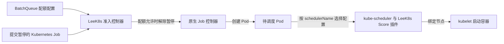

# LeeK8s

LeeK8s 是一个用 Go 开发的 Kubernetes 多租户离线作业调度项目。多个团队在同一集群提交报表、数据处理等批作业，LeeK8s 根据队列和 CPU、内存配额决定作业何时开始，并通过 Kubernetes Scheduling Framework 实验不同的 Pod 节点打分策略。

**当前状态：项目初始化。** 仓库已定义 Go 模块，控制器、调度插件和实验环境处于规划阶段。

## 作业如何运行

准入控制器按 Job 声明的资源 requests 记账，回答「哪个作业现在可以开始」。调度器按节点资源和 Pod 约束选择节点，回答「这个 Pod 可以在哪里运行」。已经获得逻辑配额的 Job，仍可能因节点容量或其他调度约束而等待。

## 里程碑

| 阶段 | 交付目标 |
| --- | --- |
| Kubernetes 链路实验 | 观察原生 Job 从提交到完成，复现并区分准入等待、Pod 调度失败和节点启动失败 |
| 单集群作业准入 | 实现 `BatchQueue` CRD、租户 CPU/内存配额、FIFO 与可查询的等待原因 |
| 策略与恢复 | 对比 FIFO 和小作业绕行，在控制器重启、API 写入结果未知时验证配额一致性 |
| 调度框架扩展 | 实现节点装箱 `Score` 插件，在多节点 kind 集群中与默认打分策略对照 |
| 端到端验收 | 提供可复现的负载、故障注入步骤与实验结果 |

主线完成后，可以继续实现跨租户配额借用和归还、作业级抢占、拓扑感知、组调度或控制器故障切换。优先扩展配额借用，并比较固定配额、自然归还和抢占归还对租户等待时间及作业重跑成本的影响。

## 开发环境

- Go 1.25，由 `go.mod` 声明。
- 后续本地验证使用容器运行环境、kind 和 kubectl，具体版本与部署命令随首个可运行版本补充。

## 设计参考

- [Kubernetes 控制器](https://kubernetes.io/docs/concepts/architecture/controller/)
- [Kubernetes Job 与暂停机制](https://kubernetes.io/docs/concepts/workloads/controllers/job/)
- [Kubernetes Scheduling Framework](https://kubernetes.io/docs/concepts/scheduling-eviction/scheduling-framework/)
- [Kueue 作业准入](https://kueue.sigs.k8s.io/docs/concepts/admission/)
